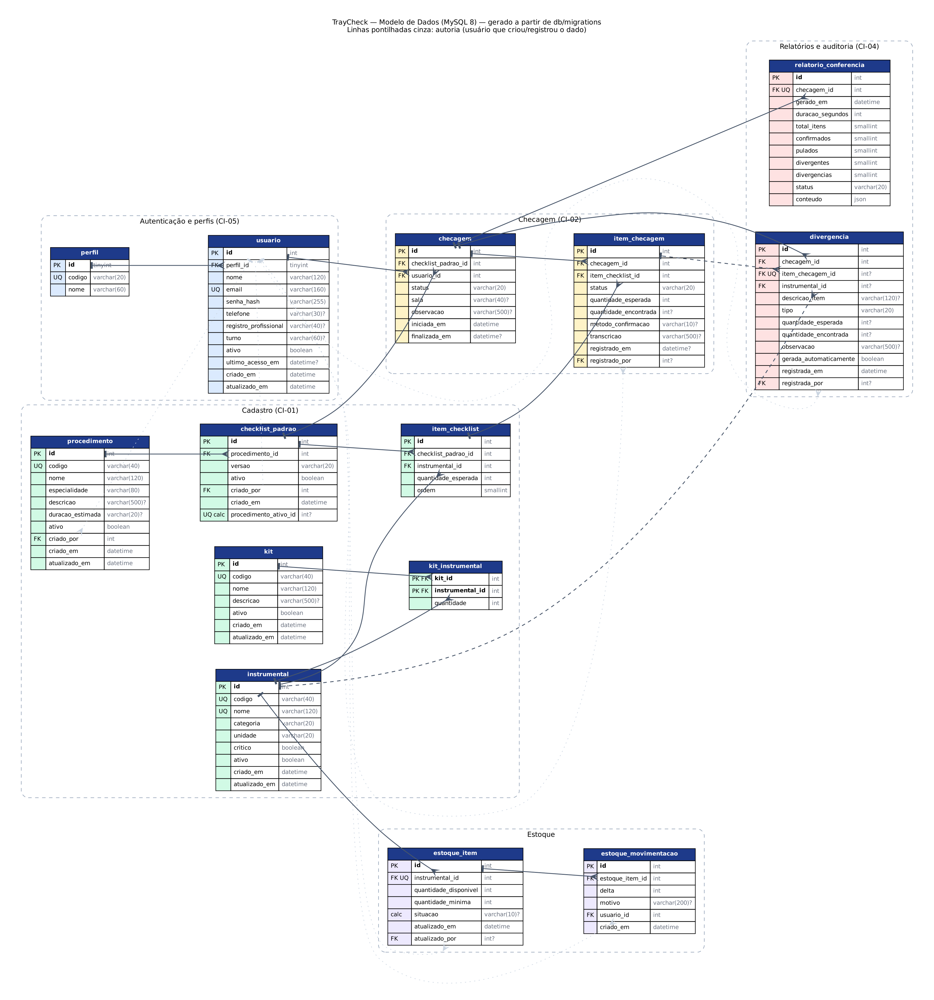

# Banco de dados — TrayCheck

Banco **MySQL 8.0+** (InnoDB, `utf8mb4`), conforme as seções 1.3 e 3.4.2 do Documento de Requisitos.
As migrações são SQL puro, numeradas no padrão `V###__descricao.sql` (compatível com Flyway e
com o cliente `mysql`), e não dependem da linguagem escolhida para o backend.

```
db/
  migrations/   Estrutura do banco, aplicada em ordem (V001 → V005)
  seeds/        Dados de demonstração (os mesmos do modo demonstração do frontend)
  der/          Diagrama entidade-relacionamento gerado a partir do banco
  aplicar.sh    Aplica migrações (e seeds) registrando as versões em schema_versao
tests/db/       Testes das regras de negócio no banco (70 verificações)
```

## Como usar

Requisitos: MySQL 8.0+ e o cliente `mysql` no PATH. A conexão usa as variáveis padrão do
cliente (`MYSQL_HOST`, `MYSQL_TCP_PORT`, `MYSQL_PWD`) e `DB_USER` (padrão `root`).

```bash
# Criar o banco com dados de demonstração
DB_NAME=traycheck ./db/aplicar.sh --seed

# Aplicar só as migrações novas (as já aplicadas são ignoradas)
DB_NAME=traycheck ./db/aplicar.sh

# Rodar os testes (cria e recria o banco descartável traycheck_teste)
./tests/db/executar.sh

# Regerar o DER depois de mudar as migrações (requer Graphviz)
DB_NAME=traycheck python3 db/der/gerar_der.py
```

Usuários de demonstração: `admin@hospitalcentral.br` / `admin123`,
`ana.silva@hospitalcentral.br` / `senha123`, `rafael.lima@hospitalcentral.br` / `circ123`;
os demais usam `traycheck123`. As senhas estão gravadas como hash bcrypt.

> Nunca altere uma migração já aplicada em um ambiente compartilhado: crie uma nova (`V006__...`).

## Tabelas e requisitos

| Migração | Tabelas | Requisitos |
| --- | --- | --- |
| V001 | `perfil`, `usuario` | RF01, RN05, RNF01 |
| V002 | `procedimento`, `instrumental`, `kit`, `kit_instrumental` | RF02, RF03, RN02 |
| V003 | `checklist_padrao`, `item_checklist` | RF04, RN02 |
| V004 | `checagem`, `item_checagem`, `divergencia`, `relatorio_conferencia` | RF05–RF10, RN01, RN03, RN04, RNF06 |
| V005 | `estoque_item`, `estoque_movimentacao` | Telas e endpoints de estoque do frontend |



## Regras de negócio garantidas pelo banco

A API continua responsável por autenticação, autorização e validação. Os gatilhos abaixo são
uma segunda barreira, para que nenhum caminho (API, script, acesso direto) quebre as regras.

| Regra | Como é garantida |
| --- | --- |
| RN01 — só finaliza com todos os itens tratados | Gatilho bloqueia `status = 'finalizada'` se houver item `pendente` |
| RN02 — só administrador cadastra procedimento e checklist | Gatilho exige que `criado_por` seja admin ativo |
| RN03 — checagem finalizada não pode ser editada ou reaberta | Gatilhos bloqueiam alterar/excluir checagem, itens, divergências e relatório após finalizar; checagens nunca são excluídas, só canceladas |
| RN04 — divergência entra automaticamente na auditoria | Item `divergente` (ou confirmado com quantidade diferente) cria a divergência; o relatório é gerado pelo banco ao finalizar |
| RF04 — histórico de checklists | No máximo um checklist ativo por procedimento; checklist já usado não pode ter itens alterados (crie nova versão) |
| RF05 — iniciar checagem | Só com checklist ativo; os itens são copiados como `pendente` com a quantidade esperada |

## Diferenças em relação ao diagrama de classes (ERS v2.1, seção 4.2)

Estas mudanças precisam ser registradas por RFC e refletidas no ERS:

1. **Login por `email`**, não `login`: é o que o frontend e o contrato da API usam.
2. **Status do item:** `pendente`, `confirmado`, `pulado`, `divergente` (RF06 e RN01). O frontend
   hoje só tem `pending`, `confirmed` e `missing`, e "pular" marca como faltante; precisa ser ajustado.
3. **`checklist_padrao.criado_por` → usuário** (no diagrama, "Perfil define ChecklistPadrao").
4. **Estoque** (`estoque_item`, `estoque_movimentacao`): não está no diagrama, mas o frontend e o
   contrato da API (`/stock`) dependem dele.
5. **Divergência ligada à checagem**, não só ao item: permite registrar excedentes que não
   estão no checklist (RF09).
6. **Associação Instrumental–Procedimento ("usado em") removida:** é derivável dos itens do checklist
   padrão; manter as duas criaria duas fontes de verdade.
7. **Campos de auditoria e LGPD:** `senha_hash`, `ativo`, datas de criação/atualização, quem
   registrou cada item, quantidade encontrada, método (voz/toque) e transcrição.

## Correspondência com o frontend

| Frontend (`mockData.ts`) | Banco |
| --- | --- |
| `UserRole`: `admin` / `nurse` / `technician` | `perfil.codigo`: `admin` / `enfermeiro` / `circulante` |
| `SurgeryType.id` (ex.: `joelho`) | `procedimento.codigo` |
| `EquipmentItem` (kit da cirurgia) | `item_checklist` + `instrumental` do checklist ativo |
| `StockItem.status`: `ok` / `low` / `critical` | `estoque_item.situacao` (mesma regra de `StockManager.tsx`) |
| `ChecklistReport` | `relatorio_conferencia` (+ `conteudo` JSON) |

Os dados de exemplo do frontend marcam "Bisturi nº 10" (8/10) e "Propofol" (6/10) como críticos,
mas pela regra do próprio `StockManager.tsx` eles são "baixo"; o banco segue a regra.
